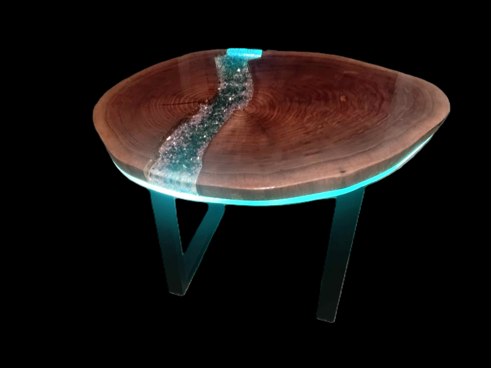
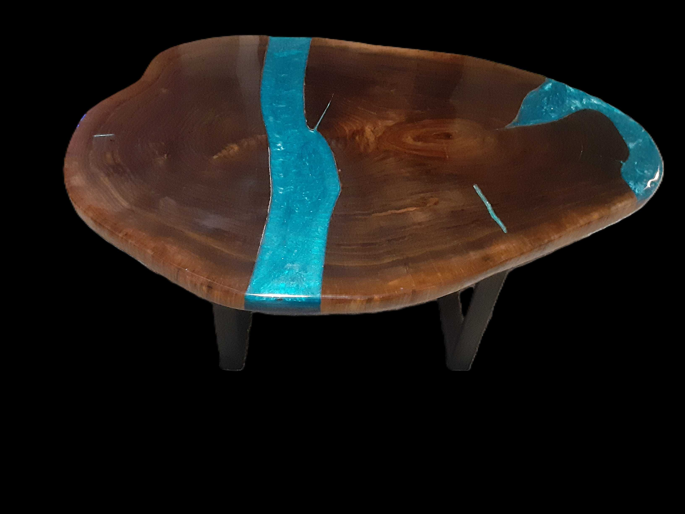
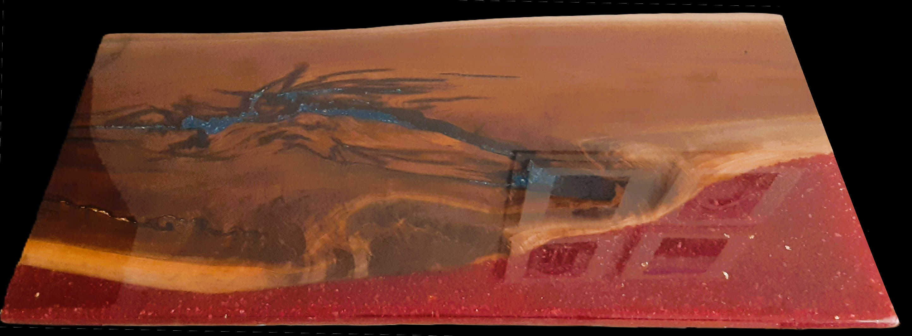

# Chemmy Tables

### Custom Wood & Epoxy Resin Creations

Welcome to **Chemmy Tables** — a furniture and woodworking brand focused on creating distinctive pieces that combine the natural beauty of wood with the creativity of epoxy resin.

This repository contains a conceptual website designed to showcase the Chemmy Tables brand, its custom furniture, and examples of handcrafted work.

---

## Featured Creations

Here are three examples of tables personally crafted for Chemmy Tables.

### Table Design 1

### Table Design 2

### Table Design 3

---

## About Chemmy Tables

Chemmy Tables celebrates the combination of natural wood, epoxy resin, and creative design. Each piece offers an opportunity to transform raw materials into a distinctive piece of functional art.

The website concept is intended to provide an online showcase for custom furniture, highlight completed projects, and introduce visitors to the Chemmy Tables brand.

---

## Project Highlights

- Conceptual business website for Chemmy Tables
- Custom website design and presentation
- Showcase of original, personally crafted furniture
- Woodworking and epoxy resin project photography

---

*Chemmy Tables — Where Wood Meets Creativity.*
